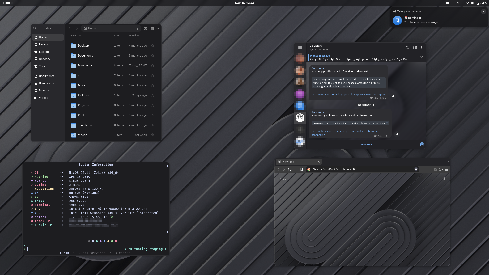

# NixOS & nix-darwin Configurations

A single Nix flake covering my NixOS and macOS machines.

## Showcase

### GNOME



### macOS


## Layout

```text
.
├── flake.nix          # Inputs, host definitions, and formatter
├── Makefile           # Common rebuild, update, and format commands
├── assets/
│   ├── screenshots/
│   └── wallpapers/    # GNOME light/dark PNGs and macOS dynamic HEIC
├── hosts/             # Machine-specific configurations
│   ├── energy/        # NixOS desktop (GNOME + gaming)
│   ├── xps/           # NixOS laptop (GNOME)
│   └── work-mac.nix   # macOS work laptop (AeroSpace)
└── modules/
    ├── common/        # Nix settings, the user.name option, terminal font, and HM wiring
    ├── nixos/         # NixOS system features (boot, audio, bluetooth, networking, gnome, gaming, …)
    ├── darwin/        # macOS system features (preferences, keyboard, users, aerospace)
    └── home/          # Home Manager base, Stylix palette, GNOME session, and per-program modules
        └── programs/  # Individual CLI/GUI tool configurations, Neovim, and scripts
```

## Conventions

- `flake.nix` wires each host directly via `nixpkgs.lib.nixosSystem` or `nix-darwin.lib.darwinSystem`.
- Settings live in the module that uses them; there is no shared preferences layer. The only custom option is `user.name` (declared in `modules/common/base.nix`, set per host).
- Baseline workstation features are imported by `modules/nixos/base.nix`, `modules/darwin/base.nix`, and `modules/home/base.nix`. This includes the desktop: GNOME on NixOS (`modules/nixos/gnome.nix`, which injects its Home Manager half, `modules/home/gnome.nix`) and AeroSpace on macOS. Opt-in features such as `modules/nixos/gaming.nix` are imported explicitly by the hosts that use them.
- Hardware support is plain NixOS options in each host's `hardware.nix` (generated by `nixos-generate-config`, plus GPU extras); there is no `nixos-hardware` input.
- Timezone and regional formats are owned by the desktop, as on macOS: set the timezone in GNOME Settings (or `timedatectl set-timezone`). The GNOME Formats region is set in `modules/home/gnome.nix` and compiled into glibc via `i18n.extraLocales` in `modules/nixos/gnome.nix`.
- `modules/home/stylix.nix` defines the shared Base16 color palette; individual `stylix.targets.*` toggles live inside the program modules they theme.

## How to use this repo for yourself

### 1. Fork and clone

Fork this repository and clone the fork.

### 2. Replace personal settings

Personal values live where they are used:

- Git name, email, and signing key: [`modules/home/programs/git.nix`](modules/home/programs/git.nix)
- Terminal font family and size: [`modules/home/programs/alacritty.nix`](modules/home/programs/alacritty.nix) (the font package is in [`modules/common/base.nix`](modules/common/base.nix))
- Keyboard layouts and regional formats: [`modules/home/gnome.nix`](modules/home/gnome.nix) and [`modules/nixos/gnome.nix`](modules/nixos/gnome.nix)
- Username: `user.name` in each file under `hosts/` (and the NixOS user description in [`modules/nixos/users.nix`](modules/nixos/users.nix))

Replace the wallpaper files with your own:

- `assets/wallpapers/wallpaper-light.png`
- `assets/wallpapers/wallpaper-dark.png`
- `assets/wallpapers/wallpaper-mac.heic`

The PNGs are applied automatically in GNOME; the HEIC contains matching light/dark variants for manual selection in macOS.

### 3. Trim or replace hosts

Update or remove hosts under `hosts/` and their entries in `flake.nix`.

### 4. Add a host

For NixOS:

```sh
mkdir -p hosts/laptop
sudo nixos-generate-config --show-hardware-config > hosts/laptop/hardware.nix
```

`hosts/laptop/default.nix`:

```nix
{
  imports = [
    ./hardware.nix
    ../../modules/nixos/base.nix
  ];

  networking.hostName = "laptop";
  user.name = "your-user";
  system.stateVersion = "26.05";
}
```

Register it under `nixosConfigurations` in `flake.nix`:

```nix
laptop = inputs.nixpkgs.lib.nixosSystem {
  specialArgs = { inherit inputs; };
  modules = [ ./hosts/laptop ];
};
```

For macOS, copy `hosts/work-mac.nix`, set `user.name` to your macOS login short name, and register the machine's short hostname under `darwinConfigurations` in `flake.nix`.

Remember to `git add` any new files before building.

### 5. Build

```sh
make nixos-rebuild     # NixOS
make darwin-rebuild    # macOS
make fmt               # format the repository
```

`make help` lists all targets. The `Makefile` defaults to `.#$(hostname -s)`, so flake outputs named after the machine's short hostname are selected automatically.

## Adding modules

- A new Home Manager program lives in `modules/home/programs/<name>.nix` and is imported in `modules/home/base.nix` (or by its parent feature if opt-in).
- A new NixOS or macOS system feature lives in `modules/nixos/<name>.nix` or `modules/darwin/<name>.nix`; import baseline defaults in the matching `base.nix` and opt-in features in the relevant `hosts/` files.

## License

MIT — see [LICENSE](LICENSE).
