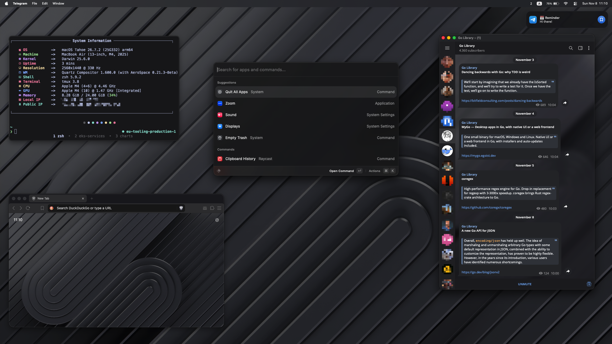

# NixOS & nix-darwin Configurations

A single Nix flake covering my NixOS and macOS machines.

## Showcase

### GNOME


### macOS



## Layout

```text
.
├── flake.nix          # Inputs, host definitions, checks, and formatter
├── Makefile           # Common rebuild, update, format, and check commands
├── assets/
│   ├── screenshots/
│   └── wallpapers/    # GNOME light/dark PNGs and macOS dynamic HEIC
├── hosts/             # Machine-specific configurations
│   ├── energy/        # NixOS desktop (GNOME + gaming)
│   ├── xps/           # NixOS laptop (GNOME)
│   └── work-mac.nix   # macOS work laptop (AeroSpace)
└── modules/
    ├── common/        # Shared NixOS + nix-darwin base, user, and font options
    ├── nixos/         # NixOS base and opt-in capabilities (gnome, gaming)
    ├── darwin/        # macOS base, preferences, keyboard, and AeroSpace
    └── home/          # Home Manager workstation modules, Neovim, and scripts
```

## Conventions

- `flake.nix` wires each host directly via `nixpkgs.lib.nixosSystem` or `nix-darwin.lib.darwinSystem`, importing the platform base (`modules/nixos/base.nix` or `modules/darwin/base.nix`) automatically.
- `modules/common/base.nix` defines typed `user` (`name`, `fullName`, `email`, `gitKey`) and `terminalFont` options, Nix daemon settings, and Home Manager integration. Home Manager modules read host-level settings through `osConfig`.
- Opt-in system features (`modules/nixos/gnome.nix`, `modules/nixos/gaming.nix`, `modules/darwin/aerospace.nix`) are imported explicitly by the hosts that use them.
- `modules/home/stylix.nix` defines the shared Base16 color palette; individual `stylix.targets.*` toggles live alongside the programs they theme.

## How to use this repo for yourself

### 1. Fork and clone

Fork this repository and clone the fork.

### 2. Replace personal settings

Edit defaults in [`modules/common/base.nix`](modules/common/base.nix) (`user.fullName`, `user.email`, `user.gitKey`, `terminalFont`) or override them per host in `hosts/`. Locale and timezone live in [`modules/nixos/base.nix`](modules/nixos/base.nix).

Replace the wallpaper files with your own:

- `assets/wallpapers/wallpaper-light.png`
- `assets/wallpapers/wallpaper-dark.png`
- `assets/wallpapers/wallpaper-mac.heic`

The PNGs are applied automatically in GNOME; the HEIC contains matching light/dark variants for manual selection in macOS.

### 3. Trim or replace hosts

Update or remove hosts under `hosts/` and their entries in `flake.nix`.

### 4. Add a host

For NixOS:

```sh
mkdir -p hosts/laptop
sudo nixos-generate-config --show-hardware-config > hosts/laptop/hardware.nix
```

`hosts/laptop/default.nix`:

```nix
{
  imports = [
    ./hardware.nix
    ../../modules/nixos/gnome.nix
  ];

  user.name = "your-user";
  system.stateVersion = "26.05";
}
```

Register it under `nixosConfigurations` in `flake.nix`:

```nix
laptop = mkNixos "laptop" ./hosts/laptop;
```

For macOS, copy `hosts/work-mac.nix`, set `user.name` to your macOS login short name, and register the machine's short hostname under `darwinConfigurations` in `flake.nix`.

Remember to `git add` any new files before building.

### 5. Build

```sh
make nixos-rebuild     # NixOS
make darwin-rebuild    # macOS
make fmt               # format the repository
make flake-check       # validate the flake
```

`make help` lists all targets. The `Makefile` defaults to `.#$(hostname -s)`, so flake outputs named after the machine's short hostname are selected automatically.

## License

MIT — see [LICENSE](LICENSE).
